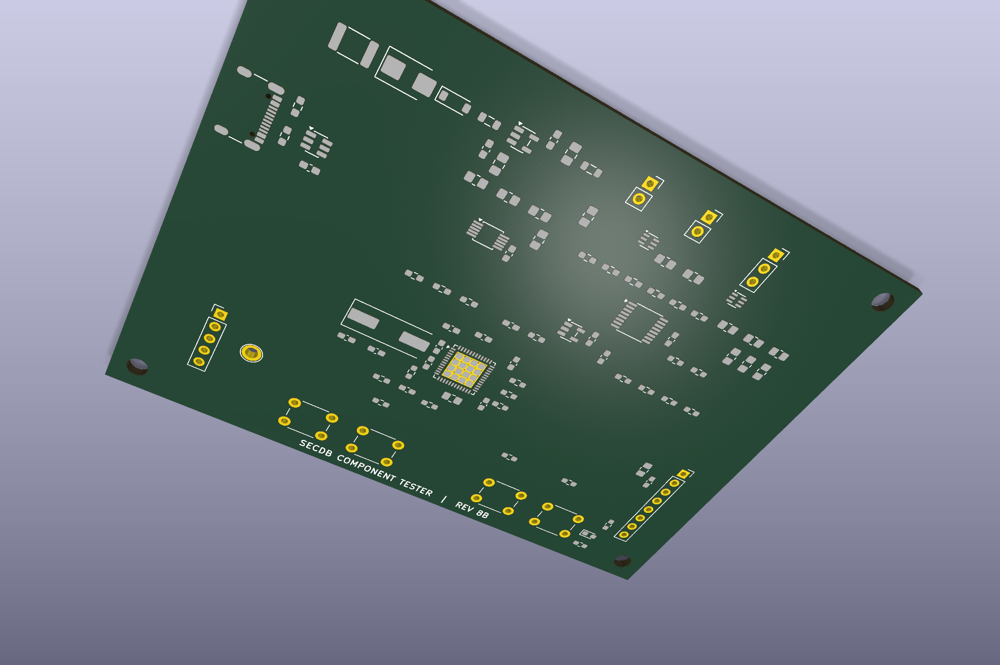

<div align="center">

# SECDB - Universal Component Tester

**An STM32-based diagnostic platform for resistors, capacitors, diodes, and known-pinout BJTs.**

[](LICENSE)


[Description](#description) · [Features](#features) · [Quickstart](#quickstart-guide) · [About](#about)

</div>

## Description

The **Smart Electronic Component Diagnostic Board (SECDB)** is a final-year ECE
project built to identify and evaluate disconnected, unpowered electronic
components. It combines an STM32F401CCU6, a protected shared analog front end,
automatic measurement ranges, calibration channels, and rule-based diagnostic
firmware.

Version 1 targets:

- resistors from **100 ohms to 1 megaohm**;
- capacitors from **100 nF to 100 microfarads**;
- silicon, Schottky, and basic LED diodes;
- known-pinout NPN and PNP BJTs with indicative hFE of approximately **20-500**.

The repository preserves the complete engineering trail: LTspice simulations,
error budgets, firmware sources, KiCad design files, verification reports, and
PCB routing checkpoints.

> [!WARNING]
> The current PCB is an engineering prototype and is **not fabrication-ready**.
> Physical calibration and hardware validation are still required.

## Screenshot and progress

<div align="center">



**Milestone progress:** `███████░░░ 70%`

</div>

| Engineering milestone | Status |
|---|:---:|
| Measurement principles and LTspice verification | Complete |
| Range selection and non-ideal error budgets | Complete |
| Shared analog front end and protection design | Complete |
| Firmware architecture and measurement algorithms | Complete at source level |
| KiCad schematic capture and ERC review | Complete |
| PCB placement and critical analog/USB routing | Complete |
| MCU monitor and DUT-drive routing | Complete |
| Remaining display, debug, button, and LED routing | In progress |
| Fabrication and board bring-up | Pending |
| Physical calibration and validation | Pending |

The progress bar is milestone-based; it does not represent manufacturing
readiness. The current board remains at the verified Phase 8D2B checkpoint with
zero KiCad DRC violations and 52 remaining unconnected items. See the
[Phase 8D3 routability review](07_KiCad/PHASE_8D3_ROUTABILITY_REVIEW.md).

## Features

- **Four component modes** - resistor, capacitor, diode, and known-pinout BJT.
- **Automatic resistor ranging** - calibrated 1 kohm, 10 kohm, and 100 kohm
  reference paths.
- **Safe capacitor handling** - discharge verification, guarded charging,
  timeout detection, and a mandatory final-discharge path.
- **Two-polarity diode diagnosis** - orientation, forward conduction, blocking,
  open, short, and ambiguous-result handling.
- **NPN/PNP BJT analysis** - active-region checks, indicative gain calculation,
  and base-off collector-emitter short confirmation.
- **Protected shared AFE** - TMUX switching, OPA391 buffering, ESD protection,
  guarded DUT paths, and calibrated ADC correction.
- **Rule-based diagnostics** - severity, confidence, measured value, reference
  bounds, deviation, and recommended action remain separate.
- **Local interface foundation** - ST7735 display, three-button navigation,
  calibration persistence, and serial diagnostic logging at source level.
- **Reproducible evidence** - simulations, test vectors, ERC/DRC reports,
  manifests, and intentional PCB checkpoints are versioned with the design.

## Prerequisites

Install only the tools needed for the part of the project you want to inspect:

| Tool | Purpose |
|---|---|
| [Git](https://git-scm.com/) | Clone and version the project |
| [KiCad 10](https://www.kicad.org/) | Open the schematic and PCB files |
| [LTspice](https://www.analog.com/ltspice) | Run the simulation decks |
| STM32CubeIDE with STM32F4 HAL | Integrate and target-build the firmware sources |

No dependency installation is required to read the reports or inspect the
existing simulation results.

## Quickstart Guide

### 1. Clone the repository

```bash
git clone https://github.com/Saurav7140/Secdb---Universal-Component-Tester.git
cd Secdb---Universal-Component-Tester
```

### 2. Open the PCB design

Open the following project in KiCad 10:

```text
07_KiCad/SECDB_Component_Tester.kicad_pro
```

The current routed board is `07_KiCad/SECDB_Component_Tester.kicad_pcb`. Review
the latest `PHASE_8*.md` and DRC reports before changing copper.

### 3. Inspect or rerun simulations

Open any `.asc` schematic or `.cir` deck in these folders:

```text
01_LTspice_Verified/
03_Range_Design/
04_Virtual_Breadboard/
05_Shared_Analog_Front_End/
```

Committed `.raw` and `.log` files preserve the verified outputs.

### 4. Explore the firmware

The portable source modules are located at:

```text
06_Firmware/Phase_6_Firmware/Core/Inc/
06_Firmware/Phase_6_Firmware/Core/Src/
```

Create an STM32CubeIDE project for the exact STM32F401CCU6 target, add these
sources, and connect the documented HAL and board callbacks. The firmware has
not yet been target-compiled against a generated CubeIDE project or validated
on physical hardware.

### 5. Follow the engineering record

- [`PROJECT_STATUS_AND_FILE_INDEX.md`](PROJECT_STATUS_AND_FILE_INDEX.md) - broad
  project history and file index.
- [`PHASE_PLAN.md`](PHASE_PLAN.md) - historical roadmap.
- [`07_KiCad/PHASE_8D2B_TWO_LAYER_REFAN_REPORT.md`](07_KiCad/PHASE_8D2B_TWO_LAYER_REFAN_REPORT.md)
  - latest completed PCB-routing checkpoint.
- [`07_KiCad/PHASE_8D3_ROUTABILITY_REVIEW.md`](07_KiCad/PHASE_8D3_ROUTABILITY_REVIEW.md)
  - current PCB decision point.

## About

SECDB is developed by [**Saurav7140**](https://github.com/Saurav7140) as an
electronics and communication engineering final-year project. The goal is to
turn sound measurement principles into a safe, explainable, and reproducible
component-diagnostic platform.

This project is available under the [MIT License](LICENSE). Contributions,
technical reviews, and hardware-validation results are welcome as the design
moves toward fabrication.

